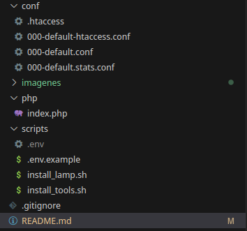
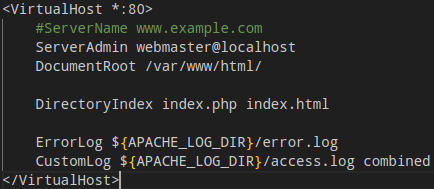

# Practica-IAW-1.1- Instalación de Apache HTTP Server, PHP y MySQL Server en Ubuntu Server

## Pasos previos a la instalación

**para la instalación vamos a tener que crear la siguiente estructura de directorios y archivos:**



**Una vez creados los archivos y directorios, procedemos a la instalación de las herramientas.**

## Instalación de Apache HTTP Server, PHP y MySQL Server en Ubuntu Server

## 1. Creación del archivo `install_lamp.sh` para la automatización del proceso de instalación

### Actualizamos el sistema y mostramos los comandos que se van ejecutando. 

```
sudo apt update
sudo apt upgrade -y
```

```
set -ex
```

## 1.1 Instalación del Servidor web Apache

```
apt install apache2 -y
```

### Paso 1: Habilitamos el módulo rewrite

```
a2enmod rewrite
```

### Paso 2: Copiamos el archivo de configuracion de apache

```
cp ../conf/000-default.conf /etc/apache2/sites-available
```

> [!IMPORTANT]  
> El archivo `000-default.conf` tiene que quedar como en la imagen:
>


### Paso 3: Instalamos PHP y algunos módulos para Apache y MySQL

```
apt install php libapache2-mod-php php-mysql -y
```

### Paso 4: Reiniciamos el servicio de apache para aplicar los cambios

```
systemctl restart apache2
```

## 1.2 Instalación de MySQL Server

### Paso 5: Instalamos MYSQL server

```
apt install mysql-server -y
```

### Paso 6: Copiamos el archivo de prueba de PHP en /var/www/html

```
cp ../php/index.php /var/www/html
```

> [!NOTE]  
> Para esto, hace falta un archivo `index.php` y que contenga el siguiente contenido:  
> "<?php
>
>phpinfo();
>
>?>"


> [!IMPORTANT]  
> Esto se hace debido a que en el archivo de configuración `000-default.conf` pusimos una línea que hace que priorice los archivos php frente a los html. Esa línea es: **`DirectoryIndex index.php index.html`**

### Paso 7: Modificamos el propietario y el grupo del archivo index.php

```
chown -R www-data:www-data /var/www/html
```
> :trollface: Lo modificamos ya que el grupo www-data pertenece al usuario con el que se ejecuta el servicio Apache y necesita permisos para ver, leer y escribir dentro de ese directorio.